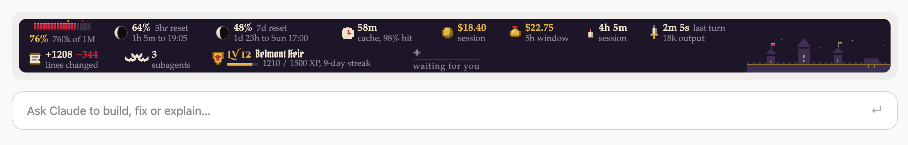
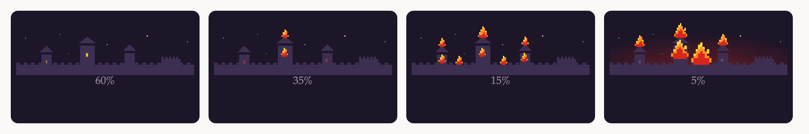
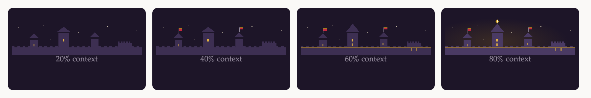
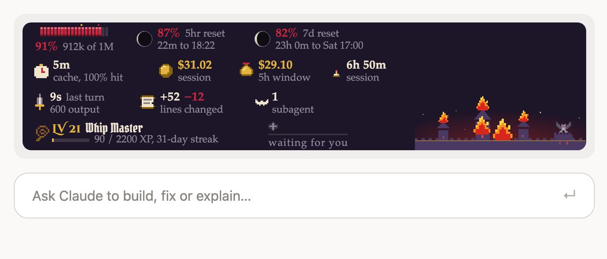
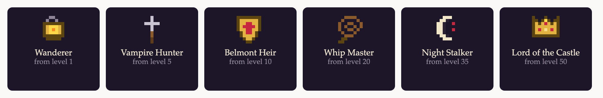

# Claude Castle Mod

A Castlevania-style HUD for Claude Code. It sits above the prompt and shows what a session is using as it goes: the context window, the rate limits, the prompt cache, the cost and the subagents. A castle on the right grows bolder as the context fills and catches fire as the prompt cache runs down.



It also has a small levelling game: you earn XP, keep a daily streak and unlock achievements as you work.

## Install

In Claude Code, run these three commands:

```
/plugin marketplace add eddywong888/claude-castle-mod
/plugin install castle-hud@claude-castle-mod
/reload-plugins
```

The HUD appears after the reload, in the desktop app's Code tab. If it doesn't show up, restart Claude Code.

A mod is code that runs inside Claude Code on your machine, with the same access Claude Code has. Read the source in `hooks/` before installing, as you would with any package.

To update later, run:

```
/plugin marketplace update claude-castle-mod
/plugin update castle-hud@claude-castle-mod
/reload-plugins
```

If the HUD doesn't change after the reload, restart Claude Code. Restart any other open windows too, so they all run the same version.

## What it shows

| | Section | What it means |
|---|---|---|
|  | **Blood meter** | How full the context window is: 20 cells, 5% each. The number turns gold from 60% and red from 85%. |
|  | **Moons** | One per rate-limit window (5-hour, and 7-day once Claude Code reports it). Full moon when the window has just refreshed, waning to a new moon as it nears its reset. Shows the percent used, the time left and the reset time. |
|  | **Stopwatch** | How long the prompt cache stays warm, and how much of the last reply's input it served. Reply while it's warm and the conversation is read from cache cheaply. |
|  | **Coin** | What this session has cost. |
|  | **Money bag** | What every session running the mod spent in the current 5-hour window. Starts again from $0 when the window resets. |
|  | **Candle** | How long the session has run. The candle burns down over eight hours. |
|  | **Dagger** | How long the last reply took and how many tokens it wrote. |
|  | **Scroll** | Lines added and removed by Claude's Edit and Write tools in this conversation. |
|  | **Bats** | One flapping bat per subagent running now. |
|  | **Thrown cross** | Beside the level, a cross spins out along a track and back while Claude works, and rests when it's your turn. |
|  | **Title icon** | Your level, title, XP toward the next level and your daily streak. The icon changes with your title. |

### The castle burns as the cache runs down

The fire follows the prompt cache. A small fire starts when 40% of the cache's life is left, a bigger one at 20%, and at 10% the whole castle is ablaze with a red glow, its windows red. That's your cue to reply while the cache is still warm. Once the cache has expired the fire goes out: there's nothing left to save. A fresh reply puts it out too.



### The castle grows as the context fills

The castle always has its three towers and the keep, and grows bolder as the context fills: banners at 40%, more lit windows, a gold trim and a taller main spire at 60%, and at 80% a gold crest, brighter stone, a soft golden glow and a stone gargoyle perched on the keep. A compaction shrinks the context, so the castle steps back down with it.





On a narrow window the sections wrap onto more rows, each at full size. The castle keeps its own column on the right, so the flames never cover a number.

## Levels, streaks and achievements

| You do | XP |
|---|---|
| Finish a turn (a cancelled one doesn't count) | +10 |
| Change lines in that turn | +1 per 10 lines, up to +50 |
| Reply while the cache is warm | +5 |
| Finish a turn under 60% context | +5 |
| Run tests that pass (npm, pnpm, yarn or bun test, pytest, jest, vitest, go test, cargo test and others) | +25 |
| A subagent finishes | +15 |

Each level needs a little more XP than the last. Titles change at level 1 (Wanderer), 5 (Vampire Hunter), 10 (Belmont Heir), 20 (Whip Master), 35 (Night Stalker) and 50 (Lord of the Castle), and each title has its own icon: a lantern, a hunter's portrait, the crest, a whip, a crescent moon and a vampire lord's portrait.



Your **streak** counts the days in a row with at least one finished turn. There are 14 **achievements**, from First Blood (your first turn) to Eternal Night (a 30-day streak). A pop-up appears for each level-up and each new achievement.

When Claude finishes a reply, a deep bell tolls under a short organ chord (an original sound made for this mod). Type `/castle sound off` to silence it and `/castle sound on` to bring it back; the choice is remembered. It rings only while a desktop app window shows the session, not in a terminal or a scripted run, and muting it in one window mutes every window. `/castle reset` keeps your choice.

Type `/castle cache 5m` if your prompt cache lasts five minutes (see *Cache life* below).

Type `/castle` to see your level, where your XP came from and every achievement. Type `/castle reset` to start again from level 1: it asks you to confirm, then deletes everything the mod recorded. Your bell and cache settings stay; to remove those too, delete the mod's file under `~/.claude/plugins/store/` (see PRIVACY.md).

## Good to know

- **Cache life.** Claude Code's prompt cache lasts either one hour or five minutes, depending on your account and model. The stopwatch counts down one hour from each reply unless you tell it otherwise. If your cache lasts five minutes, type `/castle cache 5m`; `/castle cache 1h` switches back, and `/castle cache` shows the current setting. The setting is remembered across sessions and kept by `/castle reset`. Claude Code reports the real cache life only around a model switch (when you use `/model`, or when `/resume` restores a conversation's model), and the mod then updates the setting to match. A reply counts as warm when it comes within the cache's life, and the castle's fire follows the same countdown. A compaction or a model switch starts the stopwatch again.
- **Subscription or API.** On a Claude subscription the band shows the moons and leaves out the coin and money bag, since you aren't billed per token. With an API key, or through a third-party provider, it shows the costs and leaves out the moons, which only a subscription has. Until the mod can tell, it shows both.
- **The 5-hour total** counts only sessions running this mod, from when it was installed. Usage on claude.ai or in other tools isn't included.
- **Lines changed** counts only Claude's Edit and Write tools. Files changed by shell commands such as `sed` or `git` aren't counted.
- **After a restart** a conversation's lines changed, last turn and cache stopwatch come back as they were. `/clear` starts them over; `/resume` brings back the resumed conversation's. A conversation's figures are kept for a month after you last used it.
- **XP and the 5-hour total** are kept in the mod's own storage on your machine, a file under `~/.claude/plugins/store/` whose name starts with `castle-hud_`. Nothing is sent anywhere. Each session's XP is added to one saved total when its conversation ends, so the file stays small.
- **Where it shows.** The HUD draws in the desktop app's Code tab. It draws nothing in a terminal, so a status line you've set up there stays as it is, and Claude Code doesn't offer this band in VS Code. Levels, XP and `/castle` still work everywhere.

## What the hooks do

The mod only reads what Claude Code reports. It never blocks, changes or rewrites anything.

| Hook | What it does |
|---|---|
| `session.start` | Reads the session's usage and what kind of login it has (subscription or API key, never the key itself), registers `/castle` and starts a 15-second refresh |
| `session.end` | Saves this conversation's figures and your XP, and adds the XP to the saved total |
| `turn.start` | Notes when a turn starts, to tell whether it found the cache warm |
| `session.compact` | After a compaction finishes, counts it and shows the smaller context. The compaction itself is unchanged |
| `classic.SessionStart` | When a cleared, resumed, forked or compacted conversation starts, reads its starting cost and context. A cleared or forked one starts its figures at zero; a resumed one gets its saved figures back |
| `classic.PostModelSwitch` | After `/model`, starts the cache stopwatch again and notes how long the new cache lasts |
| `session.measure` | Reads the context, rate limits and cost after each turn |
| `tool.call` | After Edit or Write succeeds, counts the lines changed. After a Bash test command passes, adds XP. Always passes the call through unchanged |
| `command.run` | Answers `/castle` with your level and achievements, `/castle sound on\|off`, `/castle cache 5m\|1h` and `/castle reset` |
| `agent.spawn` | Notes a new subagent for the bat count. The subagent starts unchanged |
| `turn.complete` | Records the last turn's time, output tokens, cache use and XP, and tolls the bell after a reply. The answer is unchanged |
| `ui.render` | Draws the HUD above the prompt |

## Development

The mod is a Claude Code plugin made of function hooks:

| File | What it holds |
|---|---|
| `hooks/register.tsx` | The hooks: usage readings, cost tracking, subagents, XP, and drawing the band |
| `hooks/svg.ts` | The pixel-art drawing for the desktop app, and the castle |
| `hooks/hud.ts` | Moons, the cache, line counting and formatting |
| `hooks/xp.ts` | Levels, streaks and achievements |
| `hooks/fonts.ts` | The level line's two fonts, trimmed and embedded (generated by `fonts/build.py`) |
| `fonts/` | The fonts' licences and the script that builds `hooks/fonts.ts` |
| `sounds/done.wav` | The bell |
| `types/index.d.ts` | The mod's state, for type-checking |

To try changes from a clone, start Claude Code with `claude --plugin-dir <this folder>`. To check them:

```bash
claude plugin validate .
```

```bash
claude plugin test .
```

The screenshots and icons are renders of the mod's own drawing code with sample numbers.

## Fonts

The level line is lettered in two fonts under the SIL Open Font License 1.1: Pirata One by Rodrigo Fuenzalida and Nicolas Massi for the title, and Cinzel Decorative by Natanael Gama for the level, each the other's fallback. The mod carries trimmed copies, renamed CastleHud Gothic and CastleHud Capitals as their licences require, with the licence texts and the build script in `fonts/`. They stay under that licence (see License below).

## License

The code is under the [MIT License](LICENSE). The fonts are not: `hooks/fonts.ts` and the files in `fonts/` are under the SIL Open Font License 1.1, whose text is in `fonts/`.
